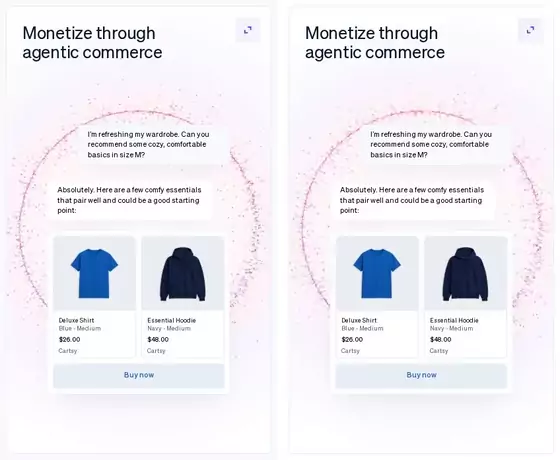
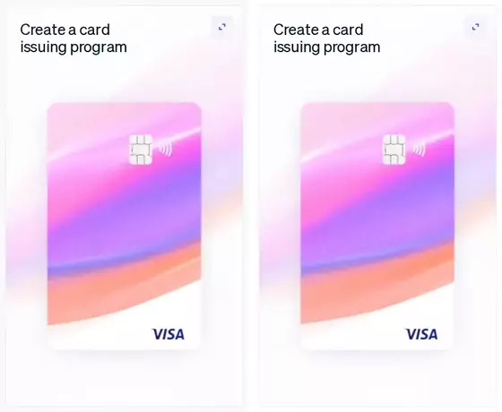
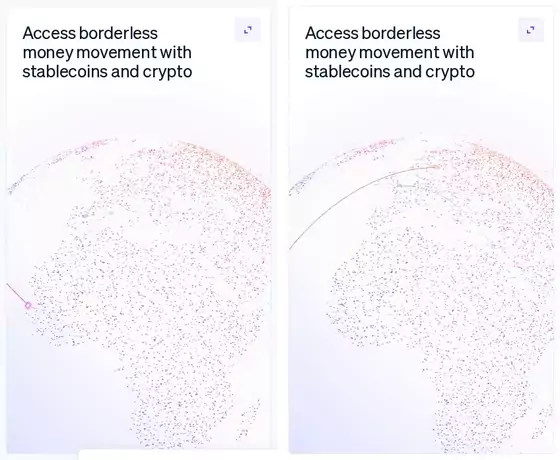

<h1 align="center">motion-clone</h1>

<p align="center"><b>A Claude Code skill that clones any animation frame by frame, then proves the copy moves the same.</b><br>From a live site, a screen recording, an mp4, a gif or a Lottie file, into your own codebase.</p>

<p align="center">
  <a href="https://code.claude.com/docs/en/skills"></a>
  <a href="https://agentskills.io"></a>
  <a href="LICENSE"></a>
  <a href="#requirements"></a>
</p>

<p align="center">
  <a href="#install"></a>
</p>

<p align="center">
  <a href="#quick-start">Quick start</a> ·
  <a href="#gallery">Gallery</a> ·
  <a href="#how-it-works">How it works</a> ·
  <a href="#writing-a-prompt">Writing a prompt</a> ·
  <a href="#whats-inside">What's inside</a> ·
  <a href="#limits">Limits</a>
</p>

<p align="center">
  
</p>

<p align="center"><sub>Three cards from the stripe.com homepage. Top: stripe.com. Bottom: the clone motion-clone built, recorded with the same command.</sub></p>

---

Copying an animation by eye goes the same way every time. The copy looks right in a screenshot and feels wrong in motion: the easing is a little sharper, the second line starts a beat late, the card lifts four pixels instead of six. Nobody can say what is off, so nobody fixes it.

motion-clone treats an animation as something to measure. Claude records the reference, reads it frame by frame and writes down every timing and easing. Then it rebuilds the animation in your stack, records the copy the same way and compares the two until the numbers agree. You get the code and the evidence: timing errors, pixel mismatch, easing fits and side-by-side sheets.

## Quick start

```sh
npx skills add NiazMorshed2007/motion-clone -g
```

The [skills CLI](https://skills.sh) asks which agents to set up. Add `-a claude-code` to skip the question.

Then, in Claude Code:

```text
/motion-clone the hero entrance on https://example.com, into components/Hero.tsx
```

The first run downloads Playwright's Chromium and a static ffmpeg into the skill's folder (about 250 MB). No API keys.

## Gallery

Each card was cloned by its own agent running this skill, in 28 to 40 minutes. Left: stripe.com. Right: the clone. Same pointer path, same recording command.

<table>
  <tr>
    <td width="33%"></td>
    <td width="33%"></td>
    <td width="33%"></td>
  </tr>
  <tr>
    <td><sub><b>Agentic commerce</b>: chat timing within 43 ms, layout within 0.05 px, 10,000-point particle ring that reacts to the pointer.</sub></td>
    <td><sub><b>Card issuing</b>: three.js. 0.03 % of pixels differ at rest; the tilt settles within 0.4 px of stripe.com's.</sub></td>
    <td><sub><b>Stablecoins and crypto</b>: globe pose exact, arc and label timings within stripe.com's own spread.</sub></td>
  </tr>
</table>

<p align="center"></p>

## How it works

| Step | What happens |
|---|---|
| **Capture** | Records the reference in a headless browser at a fixed viewport and frame rate: a video, numbered frames, every CSS and Web Animations API animation it finds, and the position of chosen elements on every frame. |
| **Spec** | One row per element per property: start, duration, from → to, easing, stagger. A row with a "?" means the frames haven't been read yet. |
| **Build** | Implements it with what your project already uses: CSS, Framer Motion, GSAP, three.js. |
| **Verify** | Records the clone with the exact same command, then compares timing, pixels and easing curves and builds side-by-side sheets. |
| **Repeat** | Fixes the smallest thing the evidence points at and records again, usually 2 to 5 rounds. A row that still fails after 5 is reported with its numbers and the reason. |

How close it has to be depends on your words:

| Level | Say | Must match |
|---|---|---|
| Motion-faithful (default) | "clone this animation" | trigger, order, stagger, timing within 80 ms, easing family, distance |
| Pixel-faithful | "match it exactly", "pixel-perfect" | all of the above plus fonts, sizes, colours, spacing, assets; ≤ 2 % mean pixel mismatch |
| Mixed | "clone X and add Y" | the cloned parts at one of the levels above; your additions kept separate |

## Writing a prompt

Name the thing, where it is and where it should go. Narrow it to one section, one widget or a time range when you only want part of it.

```text
/motion-clone the hero entrance on https://example.com, into components/Hero.tsx
/motion-clone this loader, 0:03 to 0:05 of ~/Downloads/loader.mov
/motion-clone the card hover in this gif, match it exactly
/motion-clone the logo marquee from https://example.com, with our logos and pause on hover
```

## What's inside

| Path | What it is |
|---|---|
| `SKILL.md` | The workflow Claude follows: scope, capture, spec, build, verify, report. |
| `references/` | Capture recipes per source type, how to read frames into a spec, implementation patterns per stack, pass criteria and fixes. |
| `scripts/capture.ts` | Records a page: video, frames, declared animations, computed styles, fonts, libraries, per-frame element tracks. Triggers: load, scroll, hover, leave, pointer path, drag, click, none. |
| `scripts/frames.ts` | Extracts and crops frames from a video or gif. |
| `scripts/compare.ts` | Frame-by-frame comparison: alignment, timing error, mismatch, activity curves, diff images. |
| `scripts/easing.ts` | Fits a tracked property to named easings, detects overshoot and springs, diffs two tracks. |
| `scripts/sheet.ts` | Labelled contact sheets and reference / clone / diff comparison sheets. |

## Requirements

- [Bun](https://bun.sh) 1.1 or later.
- macOS or Linux. Windows is untested.
- About 250 MB on first run for Chromium and ffmpeg, installed by `scripts/setup.sh` into the skill's own folder.

The skills CLI can install it for other agents that read `SKILL.md`, but it has only been tested with Claude Code.

## Limits

- WebGL and canvas are compared as pixels. Random content, like particles, never matches exactly, so it is judged against two recordings of the reference.
- Headless browsers draw WebGL in software, so frame pacing in recordings differs from a real screen.
- Pages behind a login, YouTube and Loom can't be recorded directly; hand it a screen recording.
- Physics springs are fitted from their overshoot and settle time, not read from the source.
- It clones what you point it at. Fonts, images and code from another site still belong to their owners; make sure you may use what you copy.

## License

[MIT](LICENSE). The gallery recreates three cards from stripe.com as a study of the technique; it is not affiliated with or endorsed by Stripe. Stripe and Visa are trademarks of their respective owners.
